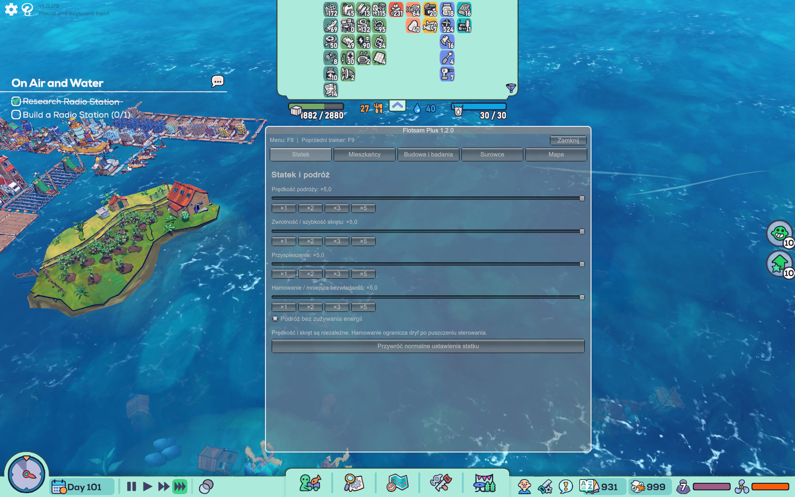

# Flotsam Plus

An **F8 menu in English and Polish** for town weight capacity, ship handling, residents, skill points, map discovery, construction, research and resources.

**[⬇ Download Flotsam Plus 1.4.0](https://github.com/arasusx-cyber/flotsam-plus/raw/refs/heads/main/dist/Flotsam_Plus_1.4.0.zip)** · [Polski](README.md) · [Installation](docs/INSTALL_EN.md)

Windows x64 · BepInEx 5.4.x · Version 1.4.0

## New in 1.4.0

Open **F8 → Window** to choose:

- **Background color:** graphite, navy, green, burgundy, light, or custom RGB.
- **Transparency 0–100%:** affects only the panel background. Text and buttons keep their opacity. The default background is almost solid.
- **Window size:** width/height sliders, presets, and a bottom-right resize grip.
- **Text 12–20 px:** automatic light/dark foreground colors. Buttons wrap in narrow windows, and every tab scrolls.

Appearance, position and size are saved. **Ctrl+F8** opens the menu and restores a readable default without changing gameplay options or language. Scrolling over the menu also suppresses the game's zoom input.

All 1.3.0 features remain, including live **PL / EN**, **capacity ×1–×100**, and the **disable town weight limit** switch under **Ship**.

These controls affect total town weight capacity. Storage space and the game's other construction rules remain separate requirements. Item and category names follow the game's language. The menu language does not change Flotsam's language.

| Tab | Features |
|---|---|
| Window | Color and RGB, transparency, dimensions and position, text size, appearance reset |
| Ship | Capacity ×1–×100 or no weight limit; independent travel speed, turning, acceleration and braking ×1–×5; energy-free travel |
| Residents | Hunger, thirst and nighttime sleep switches; movement ×1–×5; grant 1–100 unspent skill points to a selected resident |
| Build & research | Instant new construction/upgrades without materials; research ×1–×100 |
| Resources | Search items and insert 1–5000 into compatible storage with available space |
| Map | Reveal the available map and optionally keep revealing newly generated areas |

Settings are saved. New conveniences start disabled or at ×1; earlier configuration remains compatible. Ship reset also restores native weight capacity. Full reset disables all conveniences and keeps your language choice.

Speed and turning cover manual movement and route travel. Acceleration changes force-based movement; braking reduces coasting. Research still requires points and a station. Rest and construction already in progress finish normally.

Spend granted skill points in the normal character panel. XP, levels and skill caps remain native. Map discovery covers generated world tiles without activating locked story locations. Resources, granted points, completed buildings and discoveries persist in saves.

## Update / install

Close the game and extract `BepInEx` beside `Flotsam.exe`, replacing:

```text
BepInEx/plugins/FlotsamPuchatekPlus/FlotsamPuchatekPlus.dll
```

Load a save and press **F8**. Select **EN** at the top, then open **Ship** for weight capacity or **Window** for appearance. Do not keep duplicate copies of the plugin. First-time setup needs [BepInEx 5.4.21 x64](https://github.com/BepInEx/BepInEx/releases/tag/v5.4.21). The older Hansjoy trainer can remain on F9.

## In-game screenshot



*User-supplied screenshot of the working 1.2.0 menu. Version 1.4.0 includes additional language, capacity and window controls.*

## Validation

1.4.0 builds with zero errors/warnings and passes 58 logic checks plus 92 game API/IL checks against the supplied assembly. **The new 1.4.0 features still need confirmation in a running game.**

The user confirmed **1.2.0** working in-game on 8 November 2026. [Download 1.2.0](https://github.com/arasusx-cyber/flotsam-plus/raw/refs/heads/main/dist/Flotsam_Plus_1.2.0.zip). Versions 1.0.0 and 1.1.0 also remain available.

[Installation details](docs/INSTALL_EN.md) · [Development (PL)](docs/DEVELOPMENT.md) · [Changelog](CHANGELOG.md)

[MIT license](LICENSE) · [Credits](NOTICE.md)
