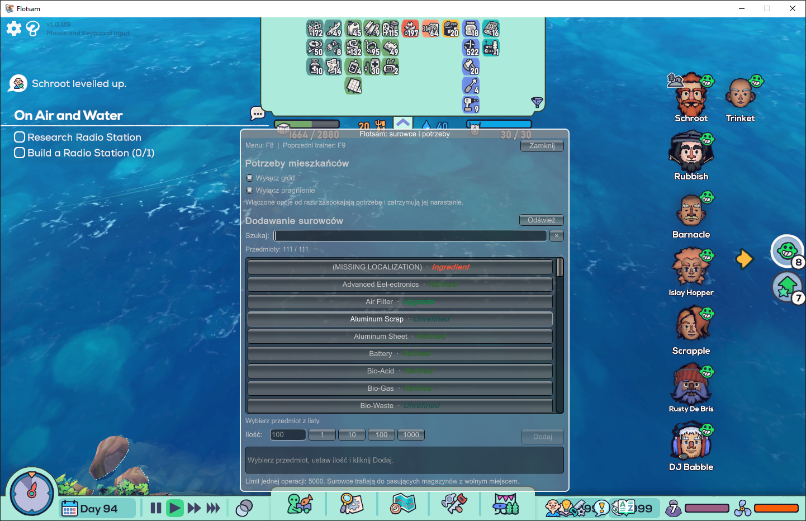

# Flotsam Plus

Dodawaj surowce i wyłącz głód lub pragnienie mieszkańców. Wszystko z polskiego menu pod **F8**.

**[⬇ Pobierz Flotsam Plus 1.0.0](https://github.com/arasusx-cyber/flotsam-plus/raw/refs/heads/main/dist/Flotsam_Plus_1.0.0.zip)** · [English](README.en.md) · [Pełna instrukcja](docs/INSTALL_PL.md)

Windows x64 · BepInEx 5.4.x · Wersja moda 1.0.0



## Funkcje

| Opcja | Działanie |
| --- | --- |
| Wyłącz głód | Zaspokaja głód mieszkańców i zatrzymuje jego narastanie. |
| Wyłącz pragnienie | Zaspokaja pragnienie mieszkańców i zatrzymuje jego narastanie. |
| Dodaj surowce | Wyszukaj przedmiot i dodaj od 1 do 5000 sztuk. |

Surowce trafiają do odpowiednich magazynów, zgodnie z ich filtrami i wolnym miejscem. Menu pokazuje rzeczywiście dodaną ilość. Ustawienia głodu i pragnienia są zapamiętywane.

## Instalacja

1. Zainstaluj [BepInEx 5.4.21 x64](https://github.com/BepInEx/BepInEx/releases/tag/v5.4.21), uruchom grę raz i zamknij ją. Jeśli już używasz BepInEx 5.4.x, przejdź dalej.
2. Wypakuj folder **BepInEx** z [paczki moda](https://github.com/arasusx-cyber/flotsam-plus/raw/refs/heads/main/dist/Flotsam_Plus_1.0.0.zip) do katalogu z **Flotsam.exe**.
3. Uruchom grę, wczytaj zapis i naciśnij **F8**.

Plik powinien znajdować się tutaj:

```text
BepInEx/plugins/FlotsamPuchatekPlus/FlotsamPuchatekPlus.dll
```

Oba przełączniki potrzeb są początkowo wyłączone. Woda wymaga magazynu na płyny. Przed pierwszym użyciem zrób kopię zapisu — dodane surowce mogą zostać zapisane w grze.

## Dokumentacja

[Obsługa i rozwiązywanie problemów](docs/INSTALL_PL.md) · [Kompilacja i rozwój](docs/DEVELOPMENT.md) · [Historia zmian](CHANGELOG.md)

Licencja [MIT](LICENSE). Zależności i autorzy: [NOTICE.md](NOTICE.md).
