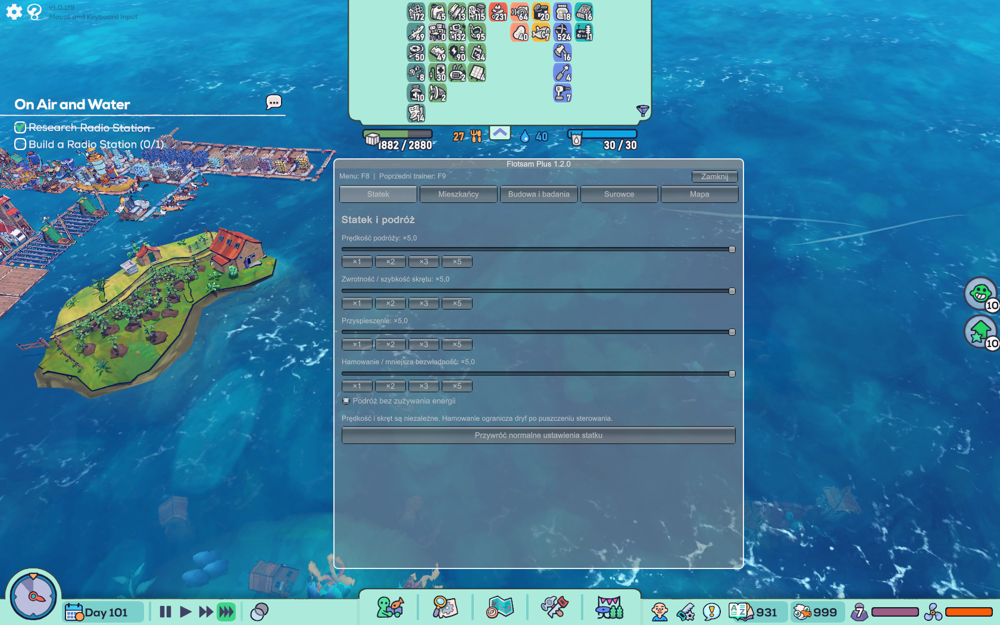

# Flotsam Plus

Menu **F8 po polsku i angielsku**: udźwig i sterowanie statkiem, mieszkańcy, punkty umiejętności, mapa, budowanie, badania i surowce.

**[⬇ Pobierz Flotsam Plus 1.3.0](https://github.com/arasusx-cyber/flotsam-plus/raw/refs/heads/main/dist/Flotsam_Plus_1.3.0.zip)** · [English](README.en.md) · [Instrukcja](docs/INSTALL_PL.md)

Windows x64 · BepInEx 5.4.x · Wersja 1.3.0

## Nowe w 1.3.0

- **PL / EN:** zmiana języka w górnej części menu, bez restartu. Tłumaczone są zakładki, przyciski, opisy i komunikaty. Wybór jest zapamiętywany.
- **Udźwig osady ×1–×100:** zwiększa limit wagi, który blokuje rozbudowę.
- **Wyłącz limit wagi osady:** pozwala budować mimo przekroczonej wagi. Włącz w **F8 → Statek**.

Mnożnik i wyłączenie limitu dotyczą wagi całej osady. Pojemność magazynów i zwykłe reguły stawiania budynków pozostają osobnymi warunkami. Nazwy przedmiotów i kategorii są pobierane z języka gry. Język menu nie zmienia języka Flotsam.

## Funkcje

| Zakładka | Opcje |
|---|---|
| Statek | Udźwig ×1–×100 lub bez limitu wagi; prędkość podróży, zwrotność, przyspieszenie i hamowanie ×1–×5; podróż bez energii |
| Mieszkańcy | Głód, pragnienie i nocny sen; ruch ×1–×5; dodawanie 1–100 punktów do rozdania wybranej postaci |
| Budowa i badania | Natychmiastowe nowe budowy i ulepszenia bez surowców; badania ×1–×100 |
| Surowce | Wyszukiwarka i dodawanie 1–5000 sztuk do pasujących magazynów z wolnym miejscem |
| Mapa | Odkrycie dostępnej mapy i automatyczne odsłanianie nowych wygenerowanych obszarów |

Ustawienia są zapamiętywane. Nowe ułatwienia zaczynają wyłączone lub na ×1. Aktualizacja zachowuje dotychczasową konfigurację. Reset statku przywraca też zwykły udźwig; pełny reset wyłącza wszystkie ułatwienia i zachowuje język.

Prędkość i skręt obejmują sterowanie ręczne i trasę. Przyspieszenie dotyczy fizycznego napędu, a hamowanie ogranicza dryf po puszczeniu sterowania. Badania nadal wymagają punktów i stacji. Istniejące place budowy i rozpoczęty wcześniej sen kończą zadania normalnie.

Punkty są do rozdania w zwykłym panelu postaci; poziom, XP i limity umiejętności pozostają bez zmian. Mapa obejmuje wygenerowane części świata i nie uruchamia zablokowanych miejsc fabularnych. Dodane zasoby i punkty, ukończona budowa oraz odkrycia zostają w zapisie.

## Aktualizacja / instalacja

1. Zamknij grę.
2. Wypakuj folder `BepInEx` z nowego ZIP-a do katalogu z `Flotsam.exe` i **nadpisz dotychczasową DLL**.
3. Wczytaj zapis i naciśnij **F8**. Język zmienisz przyciskami **PL / EN**; limit wagi w zakładce **Statek**.

```text
BepInEx/plugins/FlotsamPuchatekPlus/FlotsamPuchatekPlus.dll
```

Nie zostawiaj drugiej kopii pluginu pod inną nazwą. Pierwsza instalacja wymaga [BepInEx 5.4.21 x64](https://github.com/BepInEx/BepInEx/releases/tag/v5.4.21). Starszy trainer Hansjoy może nadal działać pod F9.

## Menu w grze



*Zrzut użytkownika z działającej wersji 1.2.0. W 1.3.0 dodano wybór PL/EN i ustawienia udźwigu.*

## Sprawdzenie wersji

1.3.0: kompilacja bez błędów i ostrzeżeń, 43 testy logiki oraz 82 kontrole API/IL względem dostarczonej DLL gry. **Nowe opcje 1.3.0 wymagają jeszcze potwierdzenia w uruchomionej grze.**

Działanie poprzedniej **1.2.0** użytkownik potwierdził 8 listopada 2026. [Pobierz 1.2.0](https://github.com/arasusx-cyber/flotsam-plus/raw/refs/heads/main/dist/Flotsam_Plus_1.2.0.zip). Starsze paczki 1.0.0 i 1.1.0 również pozostają w repozytorium.

[Obsługa i diagnoza](docs/INSTALL_PL.md) · [Rozwój i kompilacja](docs/DEVELOPMENT.md) · [Historia zmian](CHANGELOG.md)

Licencja [MIT](LICENSE). Zależności i autorzy: [NOTICE.md](NOTICE.md).
